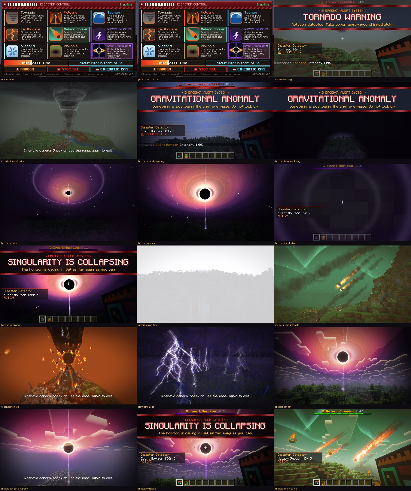

# TerraWrath

Blockbuster natural disasters for Minecraft **26.3**: tornadoes, volcanoes, tsunamis, earthquakes, meteor showers,
lightning superstorms, blizzards, sinkholes, and the signature **Event Horizon**, a black hole that
drinks the land, bends space and time around it, and ends in a supernova.



One jar works on both **Fabric** and **Forge**, and it works with **shader packs** (Iris).

## Install

| Loader | Requirements |
| --- | --- |
| Fabric | Minecraft 26.3, Fabric Loader 0.19+, **Fabric API** (needed for the TerraWrath creative tab) |
| Forge  | Minecraft 26.3, Forge 66.x |

1. Download `terrawrath-1.1.0.jar` from the Releases page.
2. Put it in your instance's `mods` folder.
3. Optional: add **Sodium + Iris** and any shader pack. TerraWrath registers its effects with Iris automatically.

Java 25 is required, as for Minecraft 26.3 itself.

## How to play

- **Disaster Control Panel**: in the **TerraWrath** creative tab, or craft it in survival. Right-click it to open
  the panel: pick a disaster, set the intensity, choose *spawn in front of me* or *nearby*, use Random or
  Stop All, or start the **Cinematic Cam** (wide drone orbit; sneak to exit, optional letterbox).
- **Disaster Detector**: in the same tab, or craft it. While it's in your inventory a HUD readout shows the
  nearest disaster, its distance and direction, and the countdown. Right-click it for a report.
- **Commands** (operators, or singleplayer with cheats on):
  - `/disaster start <type> [intensity] [front|nearby]`
  - `/disaster random`
  - `/disaster stop`
  - `/disaster list`

  Types: `tornado volcano tsunami earthquake meteor storm blizzard sinkhole horizon`
- **Natural disasters**: in survival, a random disaster strikes every 20–40 minutes, with a 30-second
  emergency-alert warning.

## Config

`config/terrawrath.json` (created on first launch):

| Key | What it does |
| --- | --- |
| `naturalDisasters` | random disasters over time |
| `minMinutesBetweenDisasters` / `maxMinutesBetweenDisasters` | timing of natural disasters |
| `naturalWarningSeconds`, `naturalIntensity` | warning length and strength of natural disasters |
| `terrainDestruction` | set to `false` to keep your builds safe |
| `maxBlockChangesPerTick`, `maxDebrisEntities` | performance limits |
| `particleMultiplier`, `screenShakeMultiplier` | visual comfort and performance |
| `giveControlPanelOnFirstJoin` | `false` by default (the panel lives in the creative tab) |

## The disasters

| Disaster | What happens |
| --- | --- |
| Tornado | 160-block funnel that rips up the land and flings it |
| Volcano | a mountain rises and erupts with lava fountains, bombs, an ash column and lava rivers |
| Tsunami | the sea pulls back, then a 40-block wave rolls in |
| Earthquake | glowing cracks, chasms, collapses and aftershocks |
| Meteor Shower | a green sky with northern lights, burning meteors and one colossal impact |
| Lightning Superstorm | a rotating black-purple supercell with nonstop branching lightning |
| Blizzard | a whiteout wall that freezes the land and anyone left outside |
| Sinkhole | the ground cracks in rings and collapses into a deep pit |
| Event Horizon | the sky goes dark, a black hole ignites, pulls in the terrain (and survival players), slows time near its core, bends light around itself, collapses, then everything goes white |

## Building from source

Requires JDK 25.

```
./gradlew build
```

The jar ends up in `build/libs/`. `tools/` contains the Python scripts that generate every texture and
sound procedurally (`gen_textures.py`, `gen_sounds.py`; numpy, Pillow and soundfile needed).

## License

MIT. See [LICENSE](LICENSE). All textures and sounds are generated by the scripts in `tools/`.
